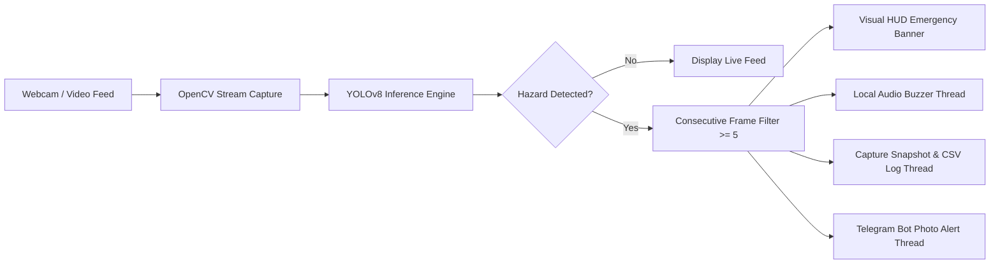

# 🔥 Real-Time Fire & Smoke Detection System 💨

[](https://www.python.org/)
[](https://github.com/ultralytics/ultralytics)
[](https://opencv.org/)
[](https://core.telegram.org/bots/api)
[](LICENSE)

An intelligent, computer vision-powered emergency safety system that monitors live video feeds, detects fire and smoke hazards using a fine-tuned **YOLOv8** deep learning model, filters out false alarms with temporal confirmation thresholds, sounds a local acoustic siren, records incident snapshots to an audit log, and delivers instant **Telegram photo notifications** to responders in real time.

---

## 🌟 Key Highlights

- **🧠 Deep Learning Hazard Classification:** Powered by YOLOv8 fine-tuned on the D-Fire safety dataset to recognize fire and smoke patterns with high precision.
- **🛡️ Temporal False-Alarm Guard:** Employs a consecutive-frame detection filter (minimum 5 continuous hazard frames) to eliminate transient noise and optical flicker.
- **⚡ Non-Blocking Asynchronous Alerts:** Runs audio sirens, Telegram uploads, and CSV persistence across detached background threads to ensure silky-smooth webcam FPS without freezing or input latency.
- **📱 Instant Remote Telegram Dispatch:** Automatically uploads timestamped high-resolution snapshot images with emergency hazard tags directly to responder Telegram groups/channels.
- **🔊 Local Audio Siren:** Triggers native acoustic alert pulses on host hardware when an emergency threshold is breached.
- **📊 Blackbox CSV Audit Trail:** Automatically appends date, timestamp, hazard classification, confidence percentage, and snapshot file paths to `incidents.csv`.

---

## 🏗️ System Architecture



---

## 📁 Repository Structure

```text
├── fire_detector.py      # Main detection engine with alerting pipeline
├── detect_fire.py        # Lightweight detection tester script
├── download_weights.py   # Automated Hugging Face weight downloader
├── test_cam.py           # Webcam hardware & FPS verification utility
├── requirements.txt      # Python dependencies
├── .env.example          # Template for Telegram Bot secrets
├── .gitignore            # Clean git exclusion rules
└── captures/             # Automated timestamped incident snapshots
```

---

## 🚀 Quick Start Guide

### 1. Prerequisites
Ensure you have Python 3.9+ installed on your machine.

### 2. Clone and Install Dependencies
```bash
git clone https://github.com/omingole87/fire-smoke-detection.git
cd fire-smoke-detection
pip install -r requirements.txt
```

### 3. Configure Telegram Alerts (Optional)
Copy `.env.example` to `.env` and configure your Telegram bot credentials:
```bash
cp .env.example .env
```
Fill in your credentials in `.env`:
```env
TELEGRAM_BOT_TOKEN="your_bot_token_here"
TELEGRAM_CHAT_ID="your_chat_id_here"
ALERT_COOLDOWN_SECONDS=30
```

> **Note:** If `.env` is omitted, the detector will still run live on camera with visual HUD and audio alerts, skipping Telegram dispatch.

### 4. Verify Camera Hardware
```bash
python test_cam.py
```

### 5. Launch Fire & Smoke Detection
```bash
python fire_detector.py
```
- Press **`q`** at any time to safely terminate the video feed and release camera hardware.

---

## ⚙️ Configuration Parameters

| Parameter | Default | Description |
| :--- | :--- | :--- |
| `CONFIRMATION_THRESHOLD` | `5` frames | Consecutive hazard frames required to trigger emergency state |
| `ALERT_COOLDOWN_SECONDS` | `30` sec | Minimum delay between consecutive Telegram dispatches |
| `conf` | `0.45` | YOLOv8 confidence score threshold |
| Camera Resolution | `640x480` | Optimized frame dimensions for real-time edge processing |

---

## 📜 License

Distributed under the MIT License. See `LICENSE` for more information.

---

**Developed with ❤️ by [Om Ingole](https://github.com/omingole87)**
